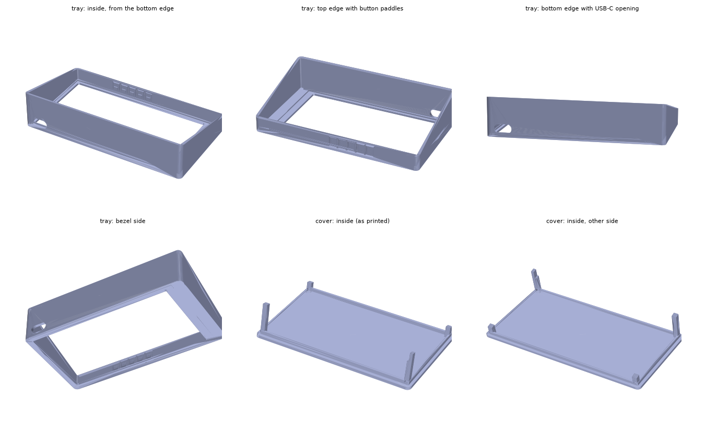

# tide-t5

A tide display for the LilyGo T5 4.7" e-paper board (original ESP32 version, with the 18650 holder),
plus a printable case.

The screen shows the current tide height and whether it is rising or falling, the next high and
low, a curve for today with a "now" marker, and a table of upcoming highs and lows. Predictions
come from the free [NOAA CO-OPS API](https://api.tidesandcurrents.noaa.gov/api/prod/), so it
covers US stations only.



## How it works

- Fetches high/low predictions over Wi-Fi every 6 hours and keeps them across deep sleep.
- Wakes every 30 minutes to redraw, then sleeps again. Height between highs and lows is a
  half-cosine interpolation.
- The station's name and time zone are looked up from NOAA, so changing station needs no rebuild.

## Build and flash

Needs [PlatformIO](https://platformio.org/). Libraries are fetched automatically.

```bash
pio run -t upload
```

Upload speed is set to 230400 baud; this board's USB bridge was unreliable above that.

## Setup

No Wi-Fi details are stored in the source.

1. On first boot the board opens a Wi-Fi network called `Tides-Setup`.
2. Join it from a phone or laptop, pick your home network (2.4 GHz) and enter its password.
3. The board connects, fetches tides and draws the screen.

## Buttons

| Button | Action |
| --- | --- |
| GPIO 39 | Refresh now |
| GPIO 34 | Change station: opens `Tides-Setup` again with a field for a NOAA station number |

Find station numbers at <https://tidesandcurrents.noaa.gov/tide_predictions.html>.
The starting station, units and timings are in [src/config.h](src/config.h).

## Case

`case/tray.stl` and `case/cover.stl` are in print orientation and need no supports. The case is a
wedge: thin at the top edge where the buttons are, deep at the bottom where the 18650 sits, so it
stands on its bottom edge.

**The case is an unprinted draft.** Its dimensions were estimated, not measured. Check every value
marked `measure` in [case/case.py](case/case.py) against your board, then regenerate:

```bash
uv run --with manifold3d --with numpy case/case.py
```

The button paddles and USB-C opening borrow ideas from
[51m0 Lab's case](https://makerworld.com/en/models/615564) for the flat-LiPo version of the board.

## License

[MIT](LICENSE)
